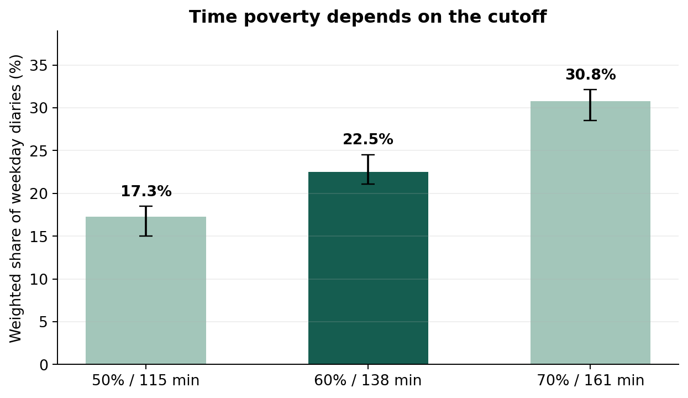
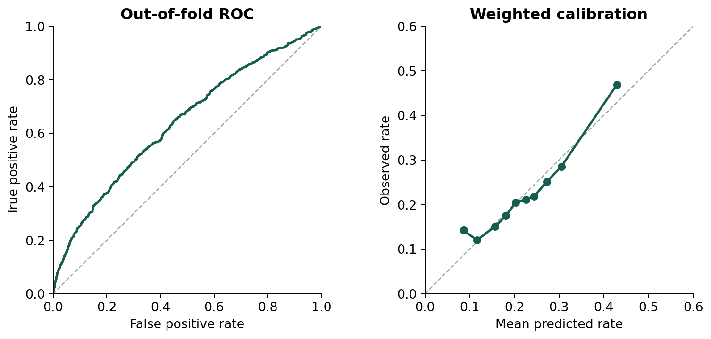
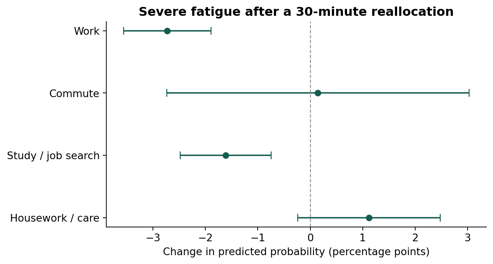
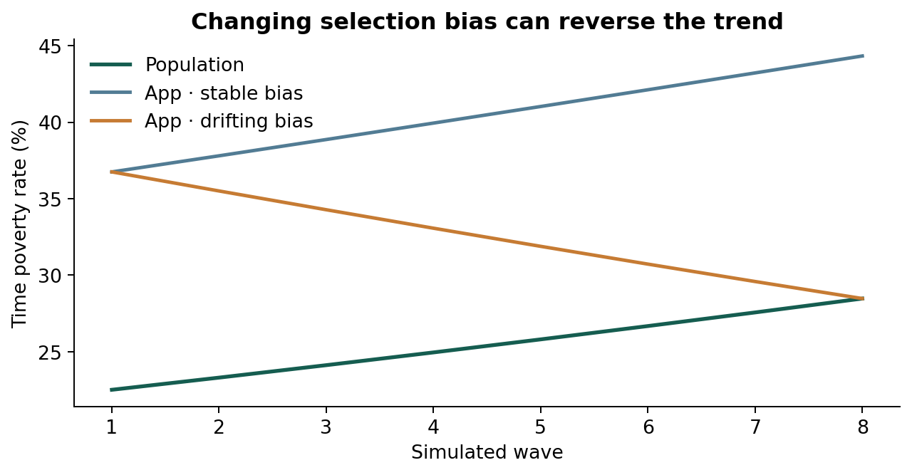

# 청년 시간 진단 연구 결과

2024 생활시간조사 공공용 시간량 자료 · 만 19–34세 · 평일 일지 · 2026-11-09 정리

## 표본과 재현 결과

원자료 50,194행·304열에서 청년 평일 일지 4,920건(3,255명)을 분석했다. 청년 평일 주행동 합계 미달 5건을 제외했다. 재량시간 가중 평균은 265.94분, 중앙값은 **230분**이다. 중앙값의 60%인 **138분 미만**은 **22.51%**였다. 기획서의 230분·138분·22.5%는 반올림 범위에서 재현됐다. 개인 단위 재표집 95% 구간은 21.08%~24.54%다. 추정 단위는 일지이며 가중치가 적용됐다.

## [0] 시간빈곤 기준의 민감도

오른쪽 네 응답률은 각 기준선 미만 일지에서 계산했다. 기준선 이상 및 전체 결과도 CSV에서 볼 수 있다.

| 중앙값 비율 | 기준선 | 가중 빈곤율 | 95% 구간 | 미만 일지 | 항상 부족 | 매우 피곤 | 여가 불만족 | 삶 불만족 |
| --- | --- | --- | --- | --- | --- | --- | --- | --- |
| 50% | 115분 | 17.28% | 14.99% ~ 18.48% | 833 | 40.21% | 43.13% | 29.56% | 13.78% |
| 60% | 138분 | 22.51% | 21.08% ~ 24.54% | 1,095 | 39.68% | 43.80% | 30.06% | 14.29% |
| 70% | 161분 | 30.75% | 28.48% ~ 32.14% | 1,521 | 37.94% | 41.85% | 29.28% | 14.42% |

60% 기준선 이상 일지에서는 항상 부족 24.44%, 매우 피곤 25.63%, 여가 불만족 16.90%, 삶 불만족 12.31%였다. 비통근 목적 이동을 필수·의무에서 제외한 대안의 중앙값은 270분이며 그 정의의 기준선으로는 20.50%가 미만이다. 공표 여가 분류만 쓴 대안은 중앙값 220분과 빈곤율 24.31%를 보였다. 표준 가중치 없이 계산한 비율은 22.26%였다.

## [1] 어떤 개인조건이 관련되는가

당일 활동시간을 제외하고 개인 특성만 투입했다. 취업자 모형에는 통상 주업·부업 시간과 종사상지위 코드도 포함했다. 아래 표의 모형별 전체 항목, 계수 및 오차는 CSV에서 확인할 수 있다.

| 모형 | 조건 | β | 개인 군집 SE | 오즈비 | 95% OR 구간 | p |
| --- | --- | --- | --- | --- | --- | --- |
| 전체 | 만 나이 5세 증가 | 0.125 | 0.062 | 1.13 | 1.00 ~ 1.28 | 0.044 |
| 전체 | 여성 | 0.391 | 0.099 | 1.48 | 1.22 ~ 1.80 | <0.001 |
| 전체 | 미취학 자녀 있음 | 0.911 | 0.178 | 2.49 | 1.75 ~ 3.53 | <0.001 |
| 전체 | 수도권 | 0.241 | 0.094 | 1.27 | 1.06 ~ 1.53 | 0.010 |
| 전체 | 취업 | 0.777 | 0.133 | 2.17 | 1.68 ~ 2.82 | <0.001 |
| 취업자 | 주업·부업 합계 10시간 증가 | 0.232 | 0.049 | 1.26 | 1.15 ~ 1.39 | <0.001 |

개인 분리 5겹 교차검증 AUC는 **0.638**로 기획서 잠정 0.650보다 0.012 낮다. 가중 Brier 점수는 0.166, 전체 비율만 사용한 비교값은 0.174다. 보정 절편 -0.090, 기울기 0.925다. 학습 폴드에서 기준선을 다시 계산한 결과도 5회 모두 138분이었다. 앱에서는 개인조건 모형 확률을 노출하지 않는다. 재현 데이터 안에서만 검증했다.

### [1-B] 가중 분위회귀

미취학 자녀가 있는 집단에서 다른 조건이 같을 때의 재량시간 조건부 분위 차이다. 개인 단위로 분위별 300회 재표집했다. 차이는 분석한 네 분위에서 모두 음수였으며 이 자료에서는 상위 분위의 점추정 차이가 더 컸다. 분위 간 차이에 대한 별도 공동 검정은 수행하지 않았다.

| 분위 | 미취학 자녀 계수(분) | 95% 구간(분) |
| --- | --- | --- |
| 0.10 | -36.7 | -60.0 ~ -12.4 |
| 0.25 | -57.0 | -74.4 ~ -39.7 |
| 0.50 | -77.5 | -106.8 ~ -61.8 |
| 0.75 | -103.3 | -132.4 ~ -65.3 |

## [2] 재배분 모형

30분을 재량시간으로 옮기는 시나리오다. 양수 행동 조합이 유지되는 일지에 한해 비교했다. 95% 구간은 해당 일지 구성을 고정하고 계수 추정의 불확실성을 개인 단위로 반영했다.

| 줄인 활동 | 응답 | 모형 일지 | 대상 가중 포괄률 | 변화(%p) | 조건부 95% 구간(%p) |
| --- | --- | --- | --- | --- | --- |
| 근로 | 항상 시간부족 | 2870 | 94.21% | -2.39 | -3.24 ~ -1.55 |
| 근로 | 매우 피곤 | 2688 | 88.10% | -2.72 | -3.56 ~ -1.89 |
| 근로 | 여가 불만족 | 2688 | 88.10% | -1.64 | -2.42 ~ -0.87 |
| 근로 | 삶 불만족 | 2587 | 85.03% | -0.77 | -1.41 ~ -0.13 |
| 통근 | 항상 시간부족 | 2348 | 96.25% | -0.62 | -3.44 ~ 2.20 |
| 통근 | 매우 피곤 | 2201 | 90.18% | +0.15 | -2.73 ~ 3.03 |
| 통근 | 여가 불만족 | 2201 | 90.18% | -1.40 | -4.02 ~ 1.22 |
| 통근 | 삶 불만족 | 2201 | 90.18% | -1.64 | -3.44 ~ 0.16 |
| 학습·구직 | 항상 시간부족 | 870 | 66.50% | -0.70 | -1.78 ~ 0.38 |
| 학습·구직 | 매우 피곤 | 698 | 53.66% | -1.61 | -2.48 ~ -0.74 |
| 학습·구직 | 여가 불만족 | 698 | 53.66% | -0.89 | -1.56 ~ -0.23 |
| 학습·구직 | 삶 불만족 | 698 | 53.66% | -0.77 | -1.55 ~ 0.01 |
| 가사·돌봄 | 항상 시간부족 | 2412 | 98.68% | +0.28 | -1.02 ~ 1.57 |
| 가사·돌봄 | 매우 피곤 | 2290 | 93.59% | +1.12 | -0.24 ~ 2.47 |
| 가사·돌봄 | 여가 불만족 | 2290 | 93.59% | +0.07 | -1.16 ~ 1.29 |
| 가사·돌봄 | 삶 불만족 | 2207 | 90.28% | -0.18 | -1.16 ~ 0.81 |

학습·구직 0분은 가중 71.42%다. 따라서 기본 분석은 0분을 그대로 둔 채 같은 양수 구성 안에서 비교했다. 1·3·6.5분 대체 민감도에서 통근 30분 재배분의 매우 피곤 예측 변화는 방향이 바뀌었다. 시나리오별 결과는 모델링 가능한 일지의 평균 예측 차이이며 관찰자료의 관련성을 요약한다.

## [3] 같은 재량시간 구간의 체감 차이

취업 청년의 항상 시간부족 응답률이다. 구간 내 재량시간, 가구 여건 및 다른 조건은 동일하다고 볼 수 없다. 특히 재량시간 중앙값 이상에서 미취학 자녀가 있는 집단은 51명이고 구간이 넓다.

| 재량시간 | 미취학 자녀 | 일지 | 사람 | 항상 부족 | 95% 구간 |
| --- | --- | --- | --- | --- | --- |
| 138분 미만 | 없음 | 738 | 596 | 37.51% | 32.71% ~ 41.39% |
| 138분 미만 | 있음 | 154 | 116 | 55.42% | 43.06% ~ 66.18% |
| 138~229분 | 없음 | 985 | 837 | 32.09% | 28.05% ~ 36.36% |
| 138~229분 | 있음 | 75 | 60 | 40.88% | 24.03% ~ 55.74% |
| 230분 이상 | 없음 | 1483 | 1137 | 25.18% | 22.15% ~ 28.52% |
| 230분 이상 | 있음 | 57 | 51 | 43.80% | 23.28% ~ 62.22% |

## [4] 시간사용 유형

시간빈곤 일지 1,095건을 분석했다. 표준화 원시간과 ilr 변환 각각에서 K=2–8을 비교했다. 표준화 원시간은 K=3, 실루엣 0.473, 개인 재표집 중앙 ARI 0.986였다. ilr은 K=2, 실루엣 0.576, 중앙 ARI 0.992였다. 앱에는 0분 관측을 유지하며 돌봄 중심 집단을 별도로 보여주는 표준화 모형을 적용했다. 두 방법에서 돌봄 유형의 분리는 달랐다.

| 유형 | 일지 | 가중 비중 | 근로(분) | 통근(분) | 학습·구직(분) | 가사(분) | 돌봄(분) | 수면(분) |
| --- | --- | --- | --- | --- | --- | --- | --- | --- |
| 학습·구직 시간 집중형 | 197 | 18.55% | 14 | 4 | 609 | 34 | 2 | 474 |
| 근로 시간 집중형 | 817 | 74.93% | 499 | 88 | 22 | 40 | 14 | 477 |
| 돌봄 시간 집중형 | 81 | 6.52% | 41 | 6 | 8 | 228 | 354 | 507 |

## 공식 공표값 교차검산

2024년 전국 10세 이상 전체 요일·성별의 전체 평균과 같은 조건에서 주행동 시간을 재현했다. 8개 지표의 최대 절대 차이는 0.366분이었다. 식사하기는 KOSIS 통계찾기 표기 및 국가데이터처 본문과 함께 확인했다. 나머지 수치는 국가데이터처 공표표 1-1에 직접 대조했다. 공표 그룹과 연구의 19–34세 평일 그룹은 범위가 다르다.

## 앱 검증과 정책 환류

±20분 입력 오차 시뮬레이션에서 전체 판정의 2.50%가 바뀌었고, 기준선 ±20분의 일지에서는 23.22%가 바뀌었다. 앱은 이 범위를 경계선으로 표시한다. Chrome에서 예시 입력, 합계 차단, 리포트, 유사 그룹, 재배분, 유형, 정책 카드, 선택 저장과 삭제를 확인했다.

현재 정책·지원·안내 데이터에는 총 10개 항목이 등록되어 있으며, 기존 8개 항목 중 2개는 온통청년에서 후보를 찾았다. 이후 수면 관련 안내 2개 항목을 추가하였다. 지역구분과 적용대상은 정책 DB에서 확인할 수 있다. 개별 모집 일정은 회차·지역·단지에 따라 달라지는 항목을 구분했다.

가상의 8개 시점과 8가지 선택편향 유형에서 가입자 구성의 변화를 모의실험했다. 편향이 일정한 설정에서는 추세 방향을 자주 재현했지만, 중간 이상의 자기선택 편향이 시간에 따라 이동하는 설정에서는 방향이 뒤집혔다. 앱 내 수요·반복 기록을 해석할 때 가입자 구성과 접속 조건을 함께 추적할 필요가 있다.

## 재현 파일

- [데이터 감사](data_audit.md), [변수 정의](../../docs/variable_mapping.md), [행동분류표](../../docs/activity_classification.csv)
- [방법론](../../docs/methodology.md), [정책 활용 및 한계](../../docs/limitations.md), [직주근접 지도 검토](../../docs/map_feasibility.md)
- [분석표 폴더](../tables/), [정책 DB CSV](../../data/external/policies.csv), [실행 안내](../../README.md)
